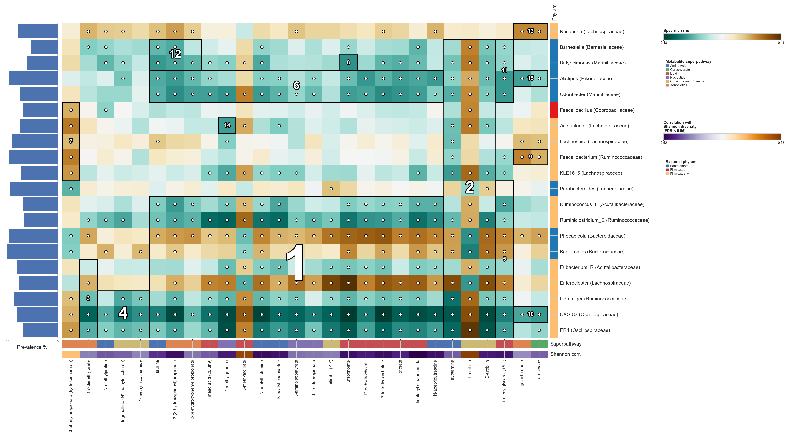
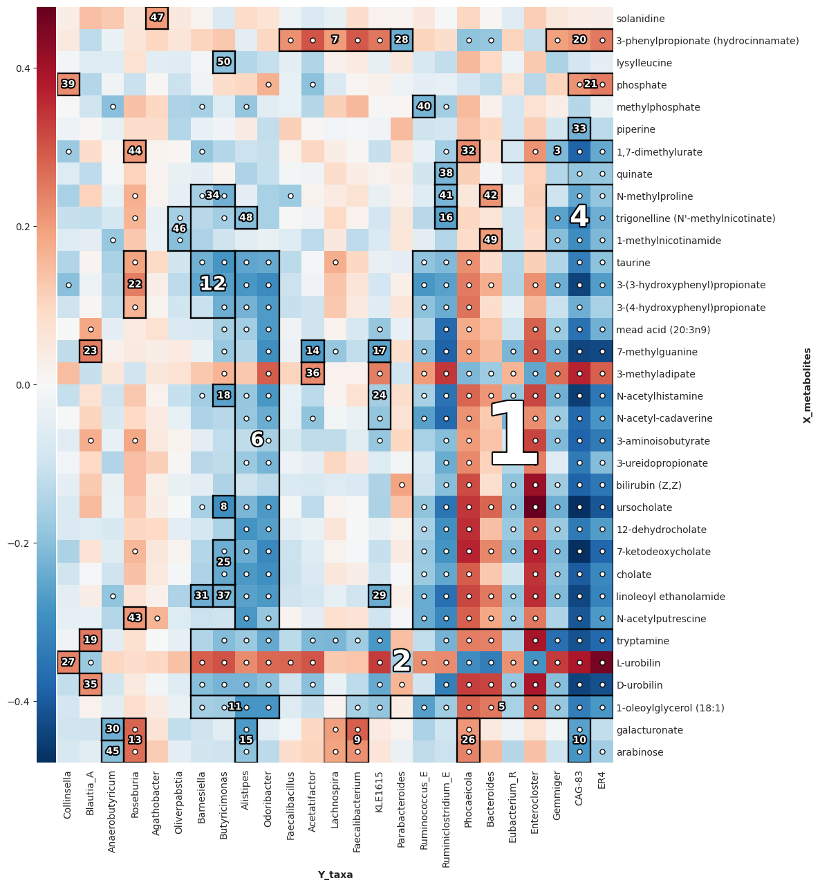
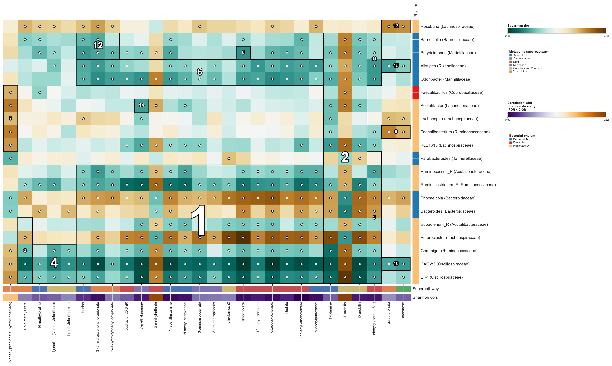
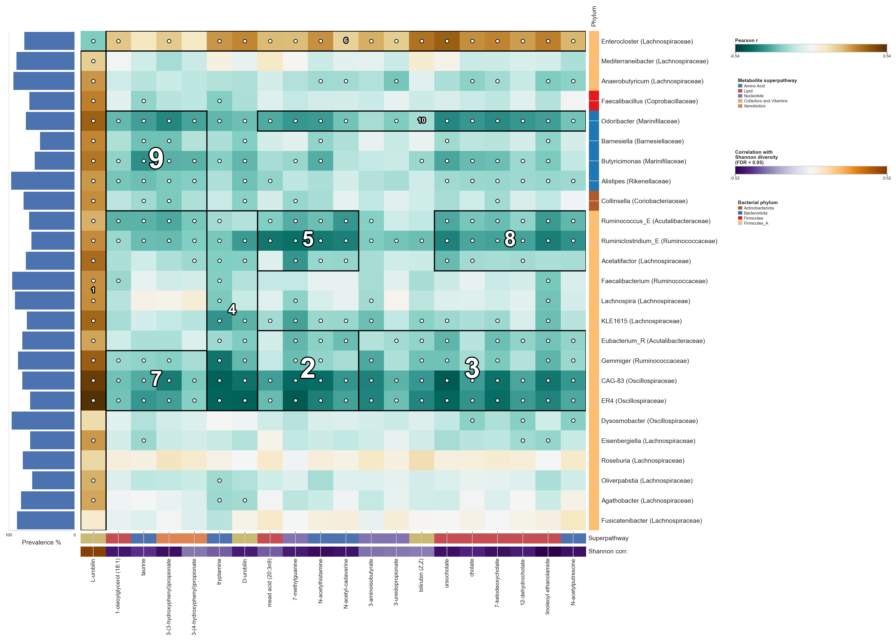
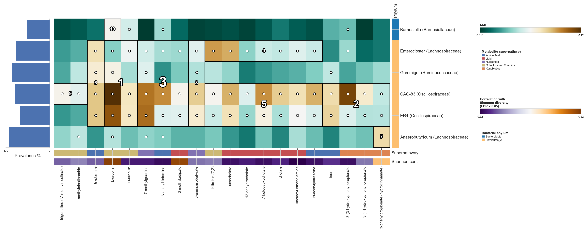

# HAllA from scratch: a Docker + notebook walkthrough

[HAllA](https://github.com/biobakery/halla) finds *blocks* of association between two datasets
measured on the same samples. For example, a group of metabolites correlated with a group of microbes, rather than one metabolite against one microbe. This repository is a complete worked
example: build the environment, run HAllA on a real paired microbiome/metabolome dataset, and building on its default output to generate figures for a manuscript.

No current knowledge of Docker, conda, or halla is required.



The figure above is an example HAllAgram which we will generate from a public microbiome-metabolome dataset. Everything in it is reproducible from
this repository in about five minutes, most of which is the one-time image build.

## Why blocks instead of pairs

HAllA clusters each dataset on its own internal structure first, then tests
*clusters* against each other, descending the two hierarchies only as far as the data supports. Ten
metabolites that all track the same underlying process get tested more or less once, not ten times.
The output is a set of rectangles ("these metabolites, against these microbes") which is usually
closer to the biological question than a ranked list of pairs.

Section 8 explains a few additional flags that you can change within a HAllA analysis, but there are many more!

## What you need

- **Docker Desktop**, installed and running. [Download](https://www.docker.com/products/docker-desktop/).
  The image needs about 6 GB of disk.
- **Python 3.9 or newer** with `pandas`, `numpy`, `scipy`, `matplotlib`, `seaborn` and `jupyter`.
  Any environment will do, including a conda base environment: `pip install -r requirements.txt`.
- No HAllA installation. That is the point of the Docker image.

## Repository layout

```
docker/Dockerfile              the HAllA environment
data/                          the tutorial's inputs, ready to use  (see data/DATA_SOURCE.md)
scripts/prepare_data.py        how data/ was built, if you want to change it
hallagram_render.py            the custom figure renderer
notebooks/halla_tutorial.ipynb runs everything
example_output/                one run's output, committed so you can look before you run
figures/                       the figures in this README
docs/native_install_macos.md   installing HAllA without Docker, and why you would rather not
```

## 1. Why Docker

HAllA is a Python package, but two of its statistical routines are R functions reached through
`rpy2`. A working install therefore needs Python, R, two R packages, and an `rpy2` compiled against
*that particular* R.

A container settles all of it once. The image pins Python 3.9, R 4.3, the two R packages and HAllA
0.8.40, and those versions cannot drift. Nothing lands on your machine outside the image, and
nothing you already have installed can conflict with it.

If you genuinely cannot use Docker, [docs/native_install_macos.md](docs/native_install_macos.md) has
the native recipe and the specific traps in it.

## 2. Build the image

From the repository root:

```bash
docker build -t halla-tutorial:0.8.40 docker/
```

A few minutes the first time, instant afterwards. Check it:

```bash
docker run --rm halla-tutorial:0.8.40 halla --version
```

## 3. The input format

Two tab-separated matrices, **features as rows and samples as columns**, and the first header cell
must be the literal character `#`:

```
#	H001	H002	H003
N-acetylhistamine	-1.526	-0.06	-2.377
piperine	-2.208	-0.055	-2.208
7-ketodeoxycholate	-0.528	0.427	-1.488
```

Remember to check the data shape

```python
X = pd.read_csv("data/X_metabolites.txt", sep="\t", index_col=0)
print(X.shape)   # (40, 240) -> 40 features, 240 samples. Not the other way round.
```

Both matrices need the same samples in the same order.

### One more constraint on names

HAllA writes the members of each cluster into `sig_clusters.txt` as a single semicolon-joined
string, so semicolons can cause errors downstream.

The toy dataset here would have hit it on both axes: GTDB taxonomy strings are semicolon-delimited, and
metabolite names like `docosapentaenoate (n3 DPA; 22:5n3)` carry one of their own.
`scripts/prepare_data.py` replaces every `;` with `,` and keeps the original string in a `label`
column, which the renderer uses for axis labels.

## 4. The data

`data/` holds a subset of a published dataset: 240 stool samples, each with 16S microbiome
profiling and untargeted metabolomics, from a colorectal adenoma study. It reaches this repository
via the Curated Gut Microbiome-Metabolome Data Resource. This resource 14 similar datasets.

Reduced to 30 genera and 40 metabolites, HAllA runs in about a second, which makes it a good size
to experiment on.

Full provenance, both citations, and the exact filters used are in
[data/DATA_SOURCE.md](data/DATA_SOURCE.md). To rebuild the inputs with different thresholds, or from
one of the other thirteen datasets, edit and run `scripts/prepare_data.py`.

## 5. Run HAllA

```bash
mkdir -p halla_runs
docker run --rm -v "$PWD:/halla" -w /halla halla-tutorial:0.8.40 \
  halla -x data/X_metabolites.txt -y data/Y_taxa.txt \
        -m spearman -o halla_runs/spearman_average \
        --fdr_alpha 0.05 --fnr_thresh 0.2 --linkage_method average \
        --hallagram --plot_file_type png --seed 42
```

Reading that command:

| Part | What it does |
| --- | --- |
| `-v "$PWD:/halla"` | makes the current directory visible inside the container at `/halla` |
| `-w /halla` | starts the container there, so every path below is relative to the repository |
| `--rm` | deletes the container when the run finishes; the output stays, in your directory |
| `-x` / `-y` | the two input matrices |
| `-m spearman` | the similarity metric. It is `-m`, **not** `--metric` |
| `-o` | output directory. It must not already exist, and its **parent must** |
| `--fdr_alpha 0.05` | the FDR threshold for calling an association significant |
| `--fnr_thresh 0.2` | how much false-negative risk to accept when descending the hierarchies |
| `--linkage_method average` | how clusters are merged; any `scipy.cluster.hierarchy.linkage` method |
| `--hallagram` | draw HAllA's built-in figure |
| `--plot_file_type png` | `pdf` instead if you want vector output for a manuscript |
| `--seed 42` | fixes the permutation tests, so reruns agree |

(Delete the output directory before rerunning.)

## 6. Reading the output

```
X.tsv  Y.tsv                 HAllA's copies of your inputs, after preprocessing
X_original.tsv  Y_original.tsv   the same, before preprocessing
X_linkage.npy  Y_linkage.npy the two dendrograms, as scipy linkage matrices
all_associations.txt         every pair, with similarity, p-value and q-value
sig_clusters.txt             the significant blocks, ranked
performance.txt              the full configuration plus result counts
hallagram.png                the built-in figure
```
Be sure to filter all_associations.txt based on your FDR

```python
assoc = pd.read_csv("halla_runs/spearman_average/all_associations.txt", sep="\t")
assoc[assoc["q-values"] < 0.05]        # 345 of 1200 pairs, in this run
```

`sig_clusters.txt` is the part that is specific to HAllA. Each row is one block: a semicolon-joined
list of X features, a semicolon-joined list of Y features, and the best adjusted p-value inside the
rectangle. In this run the top block is 17 metabolites against 9 genera, and the second is 3 against
1.  Below the top handful, most blocks are single pairs, `block_num`
exists to cap how many get drawn and improve the HAllAgram layout.

`performance.txt` has the parameters you used.

Never pass `--dont_copy`. It suppresses `X.tsv` and `Y.tsv`, and the renderer in the next section
needs them to recover feature order.

Committed output from this exact run is in [example_output/](example_output/spearman_average) if you
want to read the files before running anything.

## 7. A better figure

`--hallagram` gives you this figure:



`hallagram_render.py` redraws the same result in your own Python and lets you annotate it. Two functions:

```python
from hallagram_render import build_hallagram_inputs, render_native_hallagram

inputs = build_hallagram_inputs("halla_runs/spearman_average")
fig, _ = render_native_hallagram(inputs, dpi=200, cmap="BrBG_r", trim=True, block_num=15)
```

`build_hallagram_inputs` reads a run directory and returns the similarity matrix, the FDR-rejection
mask, the block list and the two dendrogram orderings. `render_native_hallagram` draws it.

### Annotation strips

Pass a metadata frame per axis, indexed by feature ID, and name the columns to draw:

```python
render_native_hallagram(
    inputs,
    x_metadata_df=x_meta, x_metadata_columns=["Superpathway", "Shannon corr."],
    y_metadata_df=y_meta, y_metadata_columns=["Phylum"],
    x_tick_label_col="label", y_tick_label_col="label",
    ...
)
```

Text columns become categorical strips with a legend; numeric columns become continuous strips with
a colourbar. `NaN` renders grey, which is how the "Shannon corr." strip shows metabolites whose
diversity correlation failed FDR.

The index has to match your feature IDs exactly. A mismatch raises an error rather than quietly
dropping features, which is the behaviour you want. `x_tick_label_col` is how you keep sanitised IDs
in the data and readable names on the axis.

Use the following: `category_colors` and `category_orders`. Without them the
palette is assigned from whichever categories survive trimming, so the same phylum gets a different
colour in each figure and comparisons across runs get confusing.



### The prevalence bar

`y_barplot` draws one horizontal bar per row in the left margin, aligned to the heatmap:

```python
prev = pd.read_csv("data/taxa_prevalence.txt", sep="\t")
prev_map = dict(zip(prev["feature"], prev["prevalence_pct"]))

render_native_hallagram(
    inputs, ...,
    y_barplot={"values": prev_map, "label": "Prevalence %", "vmax": 100},
)
```
That gives the figure at the top of this page.

## 8. What the settings actually do

The notebook runs the same matrices four ways. From each run's `performance.txt`:

| Run | Metric | Linkage | Absolute distance | FDR α | Significant pairs | Blocks | Largest block |
| --- | --- | --- | --- | --- | --- | --- | --- |
| `spearman_average` | spearman | average | yes | 0.05 | 345 | 102 | 17×9 |
| `pearson_complete_signed` | pearson | complete | **no** | 0.05 | 313 | 107 | 1×24 |
| `spearman_loose_fdr` | spearman | average | yes | **0.20** | 506 | 171 | 17×10 |
| `nmi_average` | nmi | average | yes | 0.05 | 184 | 108 | 2×4 |

**Spearman with average linkage** is the sensible default. It is rank-based, so it does not care
about the skew in microbiome abundances, and it catches any monotone relationship. Start here.

**Signed distance** (`--sim2dist_disable_abs`) is the setting most worth understanding. By default
HAllA clusters on `1 - |similarity|`: a strongly *anti*-correlated pair counts as similar, so
features that mirror each other land in the same block. That is usually right - a microbe that
consumes a metabolite and one that produces it are both "involved" — but it means a block can mix
directions. Disable the absolute value and clustering uses `1 - similarity`, which pushes
anti-correlated features apart.

Here the effect is dramatic. The largest block goes from 17×9 to 1×24: with signed distance the
one metabolite that correlates *positively* with most genera separates out on its own, and the
negatively-correlated majority collapses into one wide block. The underlying correlations have not
changed at all. Only the grouping has.



**Relaxing FDR α** from 0.05 to 0.20 raises significant pairs from 345 to 506 and blocks from 102 to
171, while the top blocks barely move (17×9 to 17×10). That is the shape to expect: the strong
structure is already there at 0.05, and loosening the threshold adds weak findings around the edges.
Worth doing as a sensitivity check.

**NMI** measures shared information after discretising both variables. It picks up non-monotone
relationships that Spearman misses, and it pays for that twice: it discards the direction of the
relationship — note the colourbar below runs 0.015 to 0.12, all positive — and it loses power on the
plain monotone signals. On this data that trade goes badly and the blocks fragment to 2×4.



The rest of the `-m` menu, unused above: `dcor` (distance correlation) and `xicor` (Chatterjee's ξ)
both detect non-monotone dependence without discretising, so they are usually better choices than
`nmi` when you suspect non-linearity. `mi` is raw mutual information, unnormalised.

## 9. Troubleshooting

| What you see | What is wrong |
| --- | --- |
| `Cannot connect to the Docker daemon` | Docker Desktop is not running |
| `unrecognized arguments: --metric` | the flag is `-m`, or `--pdist_metric` in full |
| `Unable to create directory halla_runs/<name>` | the parent directory does not exist, or the output directory already does. HAllA will not overwrite and will not create nested paths |
| `LibMambaUnsatisfiableError` while building | you are installing into conda's `base`. Create a dedicated environment instead |
| Run finishes, then crashes writing the figure | unpinned Pillow. Pin `"Pillow<10.0.0"` |
| `FileNotFoundError` for `X.tsv` from the renderer | `--dont_copy` was passed, or the run died partway |
| A feature is missing from the figure with no error | its name contains a `;`. See Section 3 |
| Results look plausible but make no sense | check the input orientation. Features are rows |
| `dlopen` or `R_HOME` errors | a native install, not this one. See [docs/native_install_macos.md](docs/native_install_macos.md) |
| A deprecation banner about `continuumio/miniconda3` | harmless. The upstream base image is deprecated in favour of `anaconda/miniconda`; this recipe is verified against `continuumio` |

## 10. Notes on the example result

The figures here are a demonstration of the method, not a finding. The blocks are what HAllA returns
for one filtered subset of one published dataset, with no covariate adjustment and no attempt to
account for the study groups the samples came from. Treat them as a worked example of the mechanics.

If you want to take the biology further, start from the original study: 
[data/DATA_SOURCE.md](data/DATA_SOURCE.md)

## 11. Going further

**More of the CLI.** Everything here went through the `halla` command with a handful of flags.
`docker run --rm halla-tutorial:0.8.40 halla -h` prints the full list .E.g. `--discretize_func`, `--transform_data_funcs`, `--rank_cluster`, `--permute_func`.

Two other CLI tools:

- `halladata` generates a synthetic paired X/Y dataset with a chosen association shape (`line`,
  `parabola`, `log`, `sine`, `step`, `categorical`, `mixed`) and tunable noise.
- `hallagnostic` runs diagnostic plots per block, showing the actual scatter behind a cell in the
  hallagram. These are a bit crowded and probably worth plotting separately outside of HAllA.

Both take `-h` the same way.

**More of the renderer.** `hallagram_render.py`'s `render_native_hallagram` takes several arguments
this tutorial never sets: `x_dataset_label` / `y_dataset_label` (axis titles), `legend_scale` (resize
every legend and colourbar together), and finer control over the strips — `numeric_cmaps` and
`numeric_center_zero` per column, `na_legend_labels`, `cbar_label`. Read the function's own
docstring-adjacent comments in the file; every parameter used in Section 7 above is a small subset of
what it accepts.

**The official docs.** The [biobakery wiki page for HAllA](https://github.com/biobakery/biobakery/wiki/halla)
is the canonical reference this tutorial is built on top of, and the
[biobakery/halla repository](https://github.com/biobakery/halla) has the source, the issue tracker,
and the most current CLI behavior if a flag here ever drifts from what you see on your machine.

## Citing

If HAllA does work for you, cite it:

> Ghazi AR, Sucipto K, Rahnavard A, Franzosa EA, McIver LJ, Lloyd-Price J, Schwager E, Weingart G,
> Moon YS, Morgan XC, Waldron L, Huttenhower C. *High-sensitivity pattern discovery in large,
> paired multiomic datasets.* Bioinformatics 38(Supplement_1):i378-i385 (2022).
> <https://doi.org/10.1093/bioinformatics/btac232>

The data has its own citations, in [data/DATA_SOURCE.md](data/DATA_SOURCE.md).

## License

MIT — see [LICENSE](LICENSE). `hallagram_render.py` is included under the same terms. The dataset in
`data/` comes from an MIT-licensed resource and keeps its original attribution.
